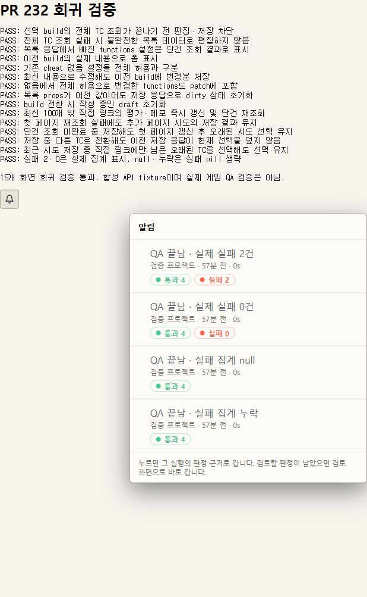

# PR 232 리뷰 오류 3건 검증

2026-10-29, PR head `49b57a9`를 기준으로 수정했다.

- 선택한 build의 version snapshot으로 대상을 찾고 `getTestCase(..., { gameBuildId })`의 전체 응답을 받은 뒤 편집한다. 조회 실패 시 기존 오류·재시도 문구를 사용한다. build가 바뀌면 draft를 초기화하고 저장 응답으로 다음 patch의 기준을 갱신한다.
- 평가 저장 결과를 목록과 선택 시도의 단건 cache에 반영하고 재조회한다. 첫 페이지 밖 시도, 단건 조회 지연, 목록 재조회 실패, 저장 중 양방향 TC 전환을 확인한다.
- 알림함은 `casesFailed`만 실패 건수로 표시한다. `0`은 표시하고 `null`·누락은 실패 pill을 생략한다.

## 검증 방법

`npm run dev -- --host 127.0.0.1 --port 5198` 실행 후 `/.plan/assets/pr232-review/index.html`을 연다. 실제 컴포넌트인 `TestCaseSheet`, `CaseEvaluationPanel`, `QaNoticeBell`에 합성 API fixture를 연결한다. 실제 게임이나 서버 데이터는 사용하지 않는다.

페이지가 자동으로 15개 조건을 확인하며, 실패하면 `FAIL`과 오류를 표시한다. 캡처는 모든 조건을 통과한 뒤의 화면이다. 실제 게임 QA나 배포 환경 E2E의 증거는 아니다.

## 자동 검사

전체 `npm test` 1,556개, `npm run build`(TypeScript 포함), 변경한 production·unit test 파일의 ESLint, `git diff --check`를 수행한다. build의 기존 bundle 크기 경고는 남는다.

## PR 기반과 범위

#232의 기능을 유지하고 #225의 디자인을 참고한다. #225 head `2f783919d9fb247a3cb58c8338dede198c065983`은 이미 #232의 ancestor이므로 기능 코드를 추가 복사하거나 history를 다시 작성할 필요가 없다. #232의 base를 #225 branch로 지정하면 두 PR의 기존 포함 관계가 드러난다.

계획 리뷰와 독립 구현 리뷰에서 발견한 전체 TC 필드 누락 및 선택 전환 race를 보완했고, 최종 구현 리뷰는 PASS다.
