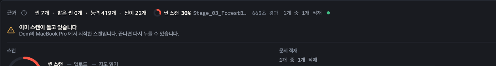
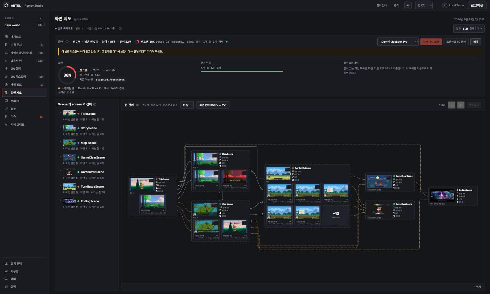
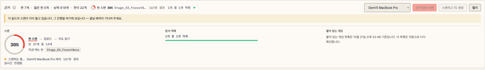

# 2026-10-21 — 화면 지도 스캔 · TC 생성 진행도 도넛과 중복 요청 안내 (ARTEL-1179)

- Date: 2026-10-21
- GitHub Issue: None (Jira ARTEL-1179)
- Status: Implemented — 서버 ARTEL-1178 · SDK ARTEL-1177 과 짝

## Goal

규모 있는 게임에서 스캔 · TC 생성이 오래 걸릴 때, 사람이 얼마나 남았는지 보게 한다. 같은 빌드에 스캔이 이미 돌고
있으면 두 번째 요청은 실패가 아니라 "이미 돌고 있다" 로 알리고 그 진행을 보인다.

## Non-goals

- 취소 버튼 — 서버 · SDK 어디에도 취소 경로가 없다. 따로 간다.
- 서버가 퍼센트를 만드는 것 — 단계마다 분모가 달라 몫은 화면이 정한다.

## Context / Constraints

- 서버(ARTEL-1178)가 `lastScan` 에 `phase`(SCANNING · UPLOADING · INGESTING · GENERATING_TEST_CASES) ·
  `progress { done, total, scene }` · `updatedAt` 을 싣고, 바뀔 때마다 SSE `scan` 을 흘린다. 같은 빌드에 스캔이
  돌고 있으면 409 `scan_in_progress`.
- 씬 진행은 SDK(ARTEL-1177)가 보낸다. 옛 SDK 면 SCANNING 에 머물러 도넛은 0% 에서 서버 단계로 건너뛴다.
- 옛 서버는 `phase` 가 없다 → 지금처럼 경과 시간만.

## Approach

- `scanProgress.ts` 의 `scanPercent` 가 단계 몫(그냥 스캔 80 · 10 · 9, TC 함께 70 · 8 · 10 · 11)으로 %를 접는다.
  100 은 서버가 SUCCEEDED 라고 한 뒤에만.
- 근거 줄: 작은 도넛 · 단계 · % · 지금 여는 씬 · 경과. 펼침: 80px 도넛 · 단계 줄(지금 단계 밑줄) · 씬 n개 중 m개 ·
  지금 여는 씬 코드 칩.
- 도넛은 문서 화면의 `ProgressRing` 을 `design-system/primitives` 로 옮겨 같이 쓴다.
- 409 `scan_in_progress` 는 오류가 아니라 경고 아이콘 + 두 줄 안내(`AlreadyRunning`). 그 스캔이 끝나면 내린다. agent 에는 실패로 돌려준다.

## Validation

- `npm test` 1316 통과, `npx tsc -b`, 바꾼 파일 `eslint`.
- 브라우저(project 2 · build 2)에서 EventSource 에 `scan` 이벤트를 넣어 SCANNING 14/37 · TC 생성 단계 · 끝남을, 스캔
  POST 를 409 로 돌려 안내를 확인. 다크 · 라이트.

## Risks

- 실제 게임으로 끝까지는 아직 못 봤다 — SDK 쪽 Unity 실행이 남았다.
