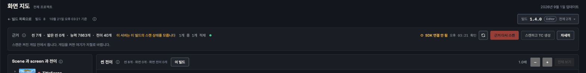
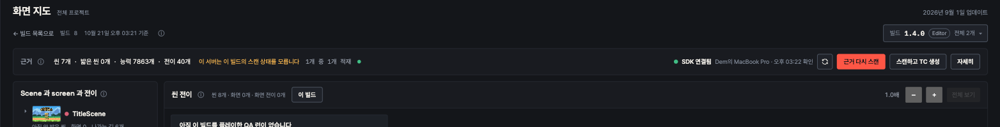
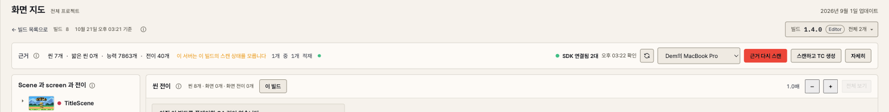

# 2026-10-21 · 화면 지도: 최신 빌드를 기본으로 열고, SDK 연결 상태와 새로고침을 보인다 (ARTEL-1185)

- Date: 2026-10-21
- GitHub Issue: None (Jira ARTEL-1185)
- Status: Implemented · ARTEL-1179 위에 쌓임
- 시안: https://claude.ai/artifact/Q7jGjugLh4yQsPJzWbgUDA

## Goal

1. `?build=` 없이 열면 빌드 고르기의 "최신" 과 같은 빌드가 열린다. project 1 은 10월의 에디터 빌드 `1.4.0` 대신 9월의 출시 빌드 `1.0` 이 열렸다.
2. 근거 줄에서 SDK 가 붙어 있는지, 언제 확인했는지 보이고, 바로 다시 확인할 수 있다.

## Non-goals

- QA · 매크로의 `selectBuild`(에디터 제외)는 그대로다.
- 새로고침은 서버가 아는 연결 상태를 다시 읽을 뿐이다. 게임에 다시 붙으라고 시키지 않는다.

## Approach

- `latestBuild.ts`: `newestFirst`(등록이 늦은 것부터, 에디터 포함)를 빌드 고르기 순서와 기본값이 같이 쓴다.
- `SdkStatus`: 확인하는 중 · 연결 상태를 확인하지 못했습니다 · SDK 연결 안 됨 · SDK 연결됨(한 대면 이름) · SDK 연결됨 n대. 늘 확인 시각을 붙인다.
- 새로고침은 몇 초마다 도는 조용한 재확인과 같은 함수(`recheckInstances`)를 쓴다. 손으로 누를 때만 "확인하는 중" 을 보이고, 실패하면 숨기지 않고 말한다.
- 게임 고르기는 두 대 이상 붙었을 때만. 안내 문장은 짧게, 대시 없이.

## Validation

- `npm test` 1320 통과, `npx tsc -b`, 바꾼 파일 `eslint`.
- project 1 이 `?build=8`(1.4.0) 로 열림. 브라우저에서 `/game-instances` 응답을 바꿔 안 붙음 · 확인 중 · 한 대 · 두 대 · 확인 실패를 다크 · 라이트로 확인.

## Risks

- 에디터 빌드는 등록 시각이 처음 붙은 때라, 그 뒤에 출시 빌드를 새로 등록하면 그 출시 빌드가 최신으로 열린다.
