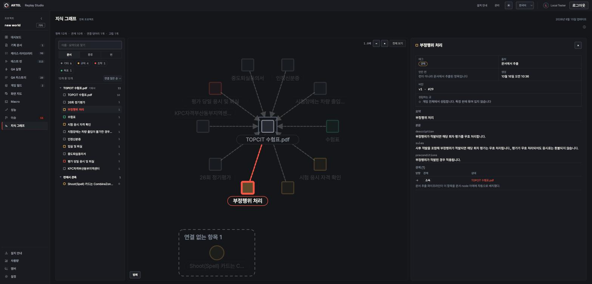
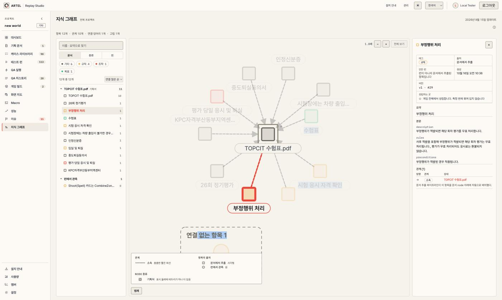
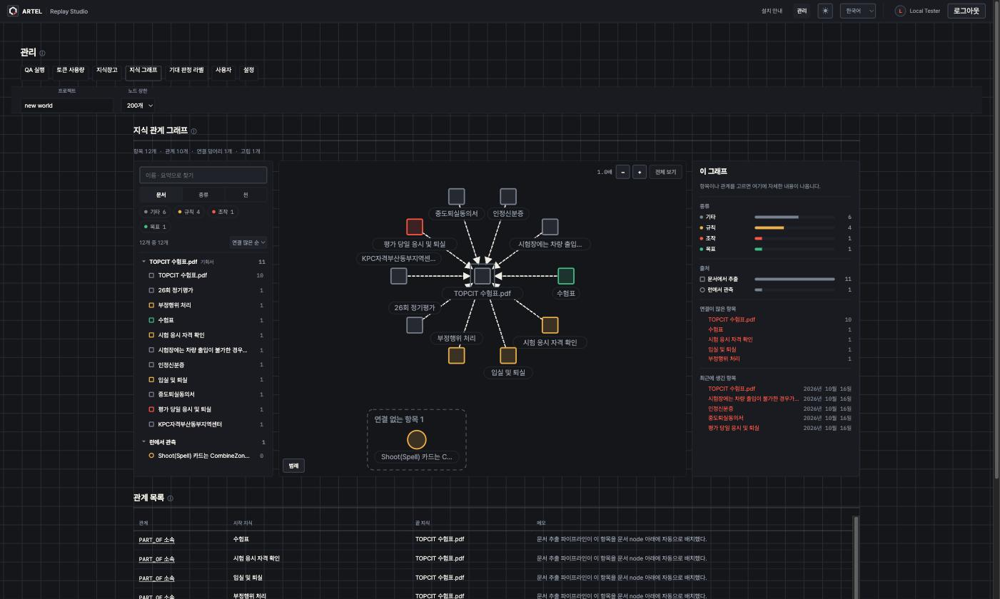

# 2026-10-21 · 지식 그래프 화면 UI 개선 (ARTEL-1190)

- Date: 2026-10-21
- GitHub Issue: None (Jira ARTEL-1190)
- Status: Implemented
- 시안: https://claude.ai/artifact/WD9ooVAnHrDwQ2cPGctd6V

## Goal

`/projects/:p/knowledge` 의 모양만 고친다. 데이터 · API · 레이아웃 계산(`knowledgeLayout`) · 힘 시뮬레이션 · 끌기 ·
agent 연결은 그대로다(팀원 작업). 화면에 빈 공간을 두지 않고, 왼쪽 · 오른쪽에 데이터를 다루기 좋은 패턴을 쓴다.

## 기능 목록 → 새 자리

| 기능 | 새 자리 |
|---|---|
| 불러오는 중 · 실패 + 다시 시도 · 항목 없음 · 잘림 배너 · 버린 관계 수(관리자) | 그대로 |
| 요약 줄(항목 · 관계 · 연결 덩어리 · 고립) | 그대로 |
| 관계 없음 안내 | 그래프 위 왼쪽에 얹음 |
| 그래프(모양 · 색 · 선 · 화살표 · 고르기 · 끌기 · 이름표 한도 안내) | 그대로 + 확대 · 이동 · 전체 보기, 이름표 바탕, 고른 항목에 닿은 선 강조, 연결 없는 항목 테두리 |
| 범례(관리자 수 포함) | 그래프 왼쪽 아래 "범례" 버튼으로 여는 팝업 |
| 인스펙터 항목 상세 | 오른쪽(고르면 칸이 460~760px 로 넓어지고 글자가 한 단계 커진다): 사실 2칸 표(종류 · 출처 · 만든 런 · 생성 · 버전/id · 성립하는 곳), 요약, 본문(`이름: 내용` 줄을 나눔), 관계 표(방향 · 관계 · 상대 + 메모) |
| 인스펙터 관계 상세 · 선택 해제 | 오른쪽 그대로, 해제는 × |
| 고른 것이 없을 때 안내 | 오른쪽에 개요(종류 · 출처 분포, 연결이 많은 항목, 최근 항목) |
| 전체 목록 + 씬 거르기 | 왼쪽 탐색기: 찾기, 묶기(문서 · 종류 · 씬), 종류 칩, 씬 거르기, 정렬, 접는 묶음, 관계 수 |
| agent `knowledge.listed` · `knowledge.openNode` | 그대로(target 은 그래프 칸) |
| 관리자 관계 표 | 그대로(세 칸 아래) |

## Approach

- 묶기 · 거르기 · 정렬은 `knowledgeGrouping.ts` 순수 함수(테스트). 문서 묶음은 `PART_OF` 구조(`documentNodeIds`)로 가린다.
- 확대 · 이동은 화면 지도의 `useCanvasViewport` 를 쓴다. 레이아웃 viewBox 가 힘이 자리 잡는 동안 · 끄는 동안 매 프레임 바뀌므로
  `keepView` 선택지를 더했다(화면 지도는 기본값이라 그대로). 노드를 누르면 노드 끌기, 바탕을 누르면 옮기기.
- 프로젝트 화면은 창 높이를 채운다(`.kg-section` 아래만). 관리자 화면은 같은 세 칸을 680px 높이로.
- 스크롤 칸(탐색기 · 오른쪽)은 `EdgeScrollbar`.

## Validation

- `npm test`, `npx tsc -b`, 바꾼 파일 `eslint`, `npx vite build`.
- project 2(항목 12 · 관계 10 · 고립 1): 고르기, 확대한 채 노드 끌기(시점 유지), 바탕 옮기기, 전체 보기, 범례, 다크 · 라이트.
- project 1(항목 1, 관계 0), `/admin/graph`(관계 표 포함), 폭 1000px(세 칸이 위아래로 쌓이고 가로 넘침 0).

## Risks

- 이름표 바탕 폭은 글꼴을 재지 않고 칸 수로 어림한다. 글꼴이 바뀌면 바탕이 글자보다 좁거나 넓을 수 있다.
- 덩어리가 여럿이면 그림 비율이 캔버스와 달라 가장자리가 빌 수 있다. 확대 · 이동으로 메운다.
