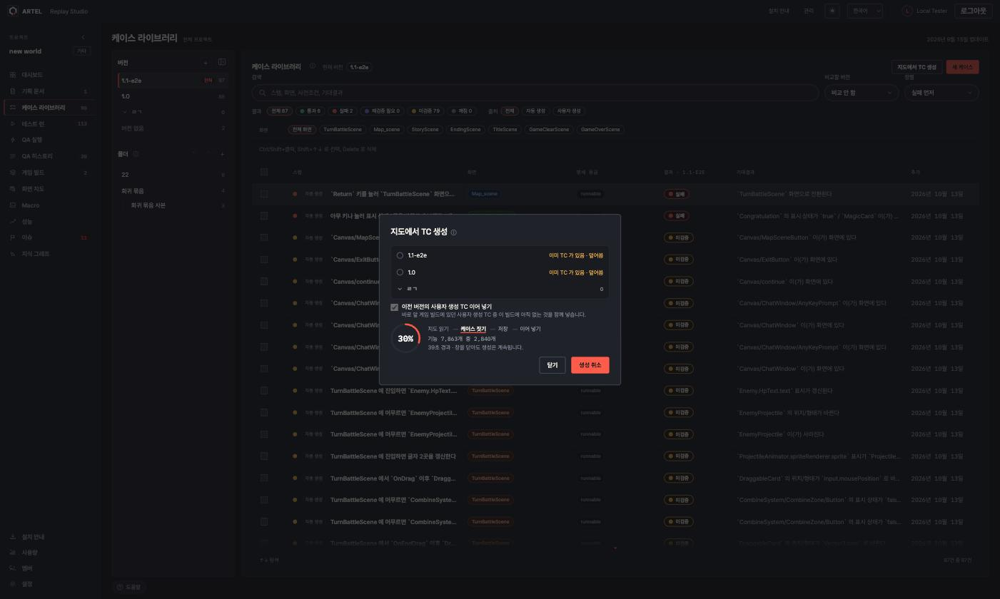
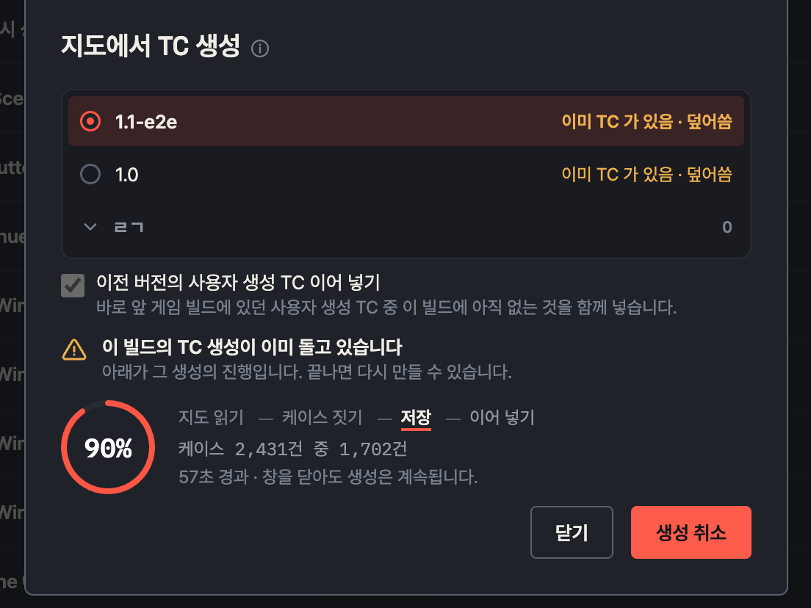
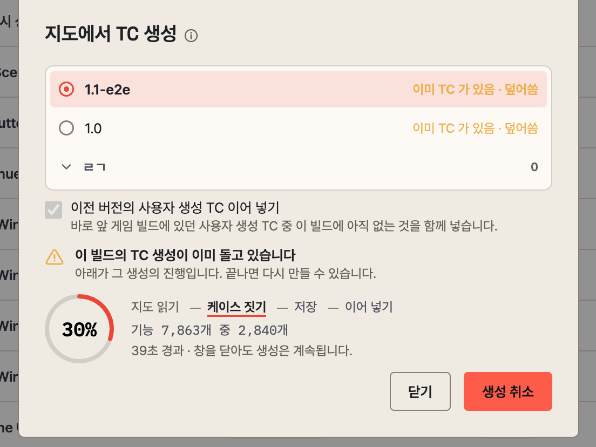

# 2026-10-21 · 지도에서 TC 생성 창에 진행도와 취소, 실패 사유를 보인다 (ARTEL-1188)

- Date: 2026-10-21
- GitHub Issue: None (Jira ARTEL-1188)
- Status: Implemented · ARTEL-1185 위에 쌓임, 서버는 ARTEL-1187
- 시안: https://claude.ai/artifact/4BkWPqcrjZRTsSwVF2eCXU

## Goal

케이스 라이브러리의 "지도에서 TC 생성" 창이 생성이 끝날 때까지 버튼만 "만드는 중" 이었다. project 1 · 1.4.0 은 8분 넘게
아무 표시 없이 돌다 "TC 를 만들지 못했습니다" 로 끝났다. 진행 · 취소 · 이미 도는 중 · 실패 사유를 창 안에서 보인다.

## Non-goals

- 서버 생성 속도는 ARTEL-1187 에서 고쳤다(1.4.0 생성 계산 309초 → 10.6초).
- 화면 지도 근거 줄의 "스캔하고 TC 생성" 은 스캔 진행(ARTEL-1179)을 그대로 쓴다.

## Approach

- `useTestCaseGeneration`: 화면 지도 SSE 에서 `snapshot` · `testCaseGeneration` 만 읽는 작은 훅. 누르는 순간 그 빌드에 붙는다.
- `generationPercent`: 단계 몫 지도 읽기 0~5 · 케이스 짓기 5~75 · 저장 75~97 · 이어 넣기 97~99. 100 은 끝난 뒤에만.
- 창: 도넛(`ProgressRing`) · 단계 줄 · 기능/케이스 수 · 경과. 도는 동안 버튼은 닫기 · 생성 취소. 닫아도 생성은 계속된다.
- 409 `TEST_CASE_GENERATION_IN_PROGRESS` 는 경고 아이콘 안내 + 그 생성의 진행, `TEST_CASE_GENERATION_CANCELLED` 는 취소 안내,
  그 밖의 실패는 서버가 남긴 사유와 멈춘 단계 · 경과.
- 덮어쓰기 확인을 누르면 확인 창을 닫고 본 창에서 진행을 보인다.
- 내 요청이 끝났으면 SSE 의 끝 이벤트를 기다리지 않는다(응답과 이벤트 순서가 바뀔 수 있다).

## Validation

- `npm test`, `npx tsc -b`, 바꾼 파일 `eslint`, `npx vite build`.
- 브라우저(project 2)에서 생성 요청과 SSE 를 흉내 내 도는 중 · 취소 · 실패 · 이미 도는 중을 다크 · 라이트로 확인.

## Risks

- 실제 서버(ARTEL-1187)를 붙인 끝까지 확인은 아직이다. 1.4.0 은 에디터 빌드라 develop 서버에서는 생성이 409 다.
