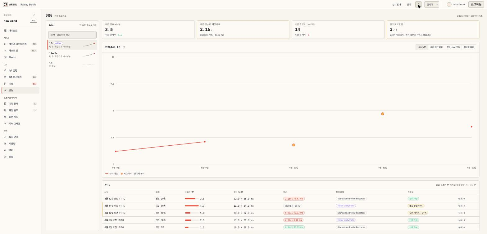
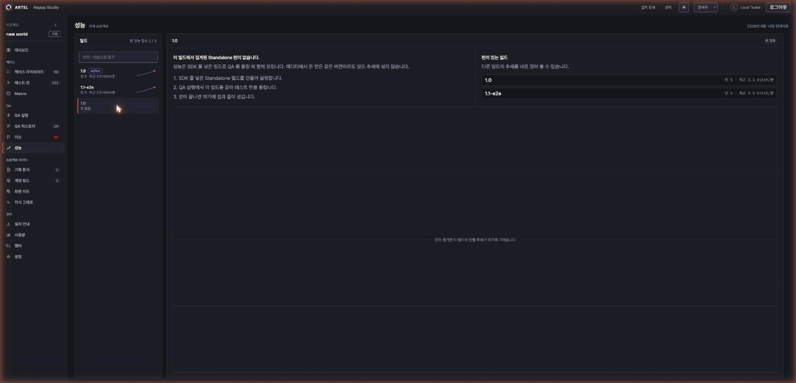
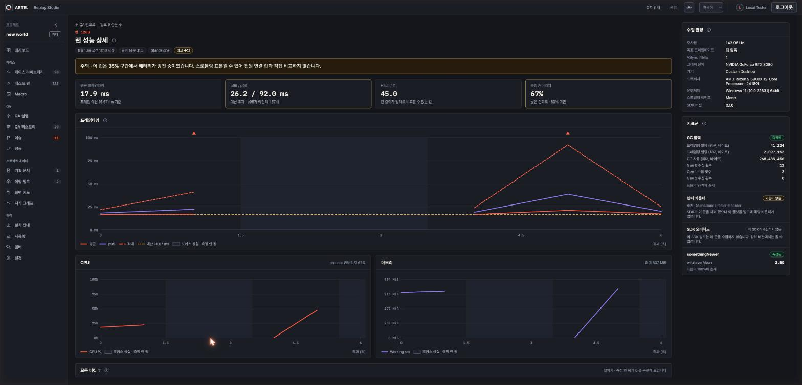

# 2026-10-22 · 성능 화면 UI 개선 (ARTEL-1207)

- Date: 2026-10-22
- GitHub Issue: None (Jira ARTEL-1207)
- Status: Implemented
- 시안: https://claude.ai/artifact/8JmAFqStopZpiJUAGLsGGi

## Goal

`/projects/:p/performance` 와 런 성능 상세(`/qa-runs/:id/performance`)의 모양만 고친다. 데이터 · API · 계약
(`performanceTypes`)은 그대로다. 넓은 화면에서 빈 곳을 두지 않고, 칸마다 서비스 스크롤 막대로 넘긴다.

## 기능 목록 → 새 자리

| 기능 | 새 자리 |
|---|---|
| 빌드 고르기(선택 상자, agent `performance.build`) | 왼쪽 빌드 목록. 높이는 화면에 고정, 목록만 넘김. 찾기 · 런 수 · 최근 Hitch/분 · 미니 추세 · editor 표시 |
| 빌드 없음 | 그대로 |
| 런 없음 | 모으는 방법 3단계 + 런이 있는 다른 빌드 바로가기 + 추세 자리 |
| Hitch/분 추세(신뢰 런만 선으로) | 그대로 + 축 · 눈금 · 날짜 · 점 위 풀이, 지표 바꾸기(Hitch/분 · p95 예산 대비 · 1% Low FPS · 메모리 최대) |
| 런 표(예산 · 렌더 출처 · 신뢰도 · 상세) | 줄 전체가 상세로. 길이 칸, Hitch 막대, 예산 대비 · 출처 · 신뢰도 칩. 최신순 |
| agent `performance.listed` · `performance.openRunReport` | 그대로 |
| 런 상세 요약 4칸 · 방전 · editor 경고 | 그대로(카드 모양) |
| 프레임 · CPU · 메모리 차트 | 그대로 + 세로 눈금, 시간 눈금, 메모리 MiB. 프레임 차트가 남은 높이를 채움 |
| 버킷 표 | 접어 둠(펼치기) |
| 수집 환경 · 지표군 | 오른쪽 칸(넓은 창) |
| 빌드 하나만 여는 주소 `game-builds/:id/performance` | 그대로 |

## Approach

- 계산은 `trendModel.ts` 순수 함수(테스트): 지표 값 · 눈금 · 빌드 요약 · 직전 런 비교.
- 빌드 목록 요약은 빌드마다 `GET .../game-builds/{id}/performance` 를 한 번씩 부른다(`useBuildDigests`). 빌드가
  수십 개로 늘면 서버가 모아 보내는 길이 필요하다.
- 차트는 칸을 재서(`useElementSize`) viewBox 를 실제 px 로 잡는다. 넓은 창에서 글자가 같이 커지지 않는다.
- 옛 `App.css` 의 성능 규칙은 `performance/performance.css` 로 옮겼다.

## Validation

- `npm test`, `npx tsc -b`, 바꾼 파일 `eslint`, `npx vite build`.
- 로컬 DB 에 성능 런이 없어 `performanceFixtures` 를 응답으로 흉내 내 확인: 빌드 셋(런 5 · 5 · 0), 지표 바꾸기,
  점 위 풀이, 줄 눌러 상세, 런 없는 빌드, 런 상세(방전 · 낮은 커버리지 · 포커스 상실 구간), 버킷 펼치기, 다크 · 라이트.

## Risks

- 빌드 목록이 빌드 수만큼 요청한다.
- 실제 서버 데이터로는 아직 못 봤다(로컬에 성능 런 0).
