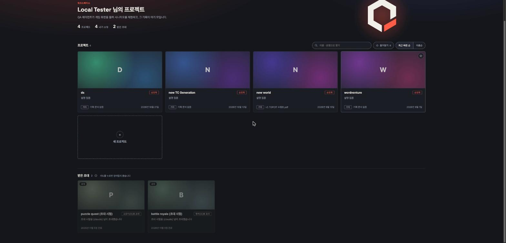

# 2026-10-22 · 프로젝트 목록 · 설치 안내 · 사용량 · 멤버 · 설정 · 계정 화면 UI 개선 (ARTEL-1208)

- Date: 2026-10-22
- GitHub Issue: None (Jira ARTEL-1208)
- Status: Implemented
- 시안: https://claude.ai/artifact/EzVZob9BSiCifEFmUdVxP7

## Goal

여섯 화면의 1240px · 1040px 가운데 칸을 풀고, 화면마다 다루는 것에 맞춘 배치로 바꾼다. 데이터 · API · agent 연결은
그대로다. 언어 고르기를 상단 바에서 계정 설정으로 옮긴다.

## 기능 목록 → 새 자리

| 화면 | 기능 | 새 자리 |
|---|---|---|
| 프로젝트 | 목록 · 장르 · 기획 문서 · 업데이트 · 더 보기 · 개수 · 새 프로젝트 · 불러오기 실패 | 카드 격자(이름 첫 글자 무늬 대표 그림, 내 역할) + 찾기 · 정렬. 머리에 인사 · 수 셋 · ARTEL 로고(한 번 그려짐) |
| 프로젝트 | 받은 초대(수락 · 거절 · 만료 · 실패) | 목록 아래 흐린 카드. 누르면 참여 확인 창, 수락하면 그 프로젝트로 이동 |
| 프로젝트 | 빈 목록 | 그림 빈 화면 |
| 설치 안내 | SDK 4단계 + 그림 · CLI 설치 · 로그인 · 명령 · Agent skills | 왼쪽에서 고른 안내 하나만(`?guide=`). 단계마다 설명과 큰 그림. 설명은 agent 안내 문서와 같은 내용으로 자세히 |
| 설치 안내 | agent `setup.showSdkPackage` · `showCliCommands` | 그 안내를 연 뒤 제목 강조 |
| 사용량 | 수치 · 잔디 · 기능별 · 모델별 | 잔디는 제 폭, 옆에 수치 2 × 2. 표 둘을 나란히, 칸 폭 고정, 긴 이름 말줄임 |
| 멤버 | 목록 · 이메일 없음 · 역할 · 참여 · 내보내기 · agent | 표 + 찾기 |
| 멤버 | 초대 보내기 · 기다리는 초대 · 취소 | 멤버 표 아래 "초대 대기 중" 칸(떼어 놓음) |
| 설정 | 일반(편집) · 이슈 트래커 · 승인 수 · 위험 구역 · agent | 왼쪽 목차 + 칸 격자 |
| 계정 | 프로필 · 이메일 · LLM 키 · CLI 토큰 | 왼쪽 목차 + 칸 격자 |
| 상단 바 | 언어 고르기 | 계정 설정의 "환경" 칸(계정에 저장은 그대로) |

## Validation

- `npm test`, `npx tsc -b`, 바꾼 파일 `eslint`, `npx vite build`.
- 로컬(project 2, 8080)에서 여섯 화면 확인. 받은 초대는 로컬에 없어 응답을 흉내 내 카드와 확인 창을 봤다(수락은 누르지 않음).
- 언어: English 로 바꾸면 화면이 바뀌고 서버 `locale` 이 바뀐다. 한국어로 되돌림.

## Risks

- 대표 이미지는 서버에 칸이 없어 무늬만 그린다. 올리기는 orche 작업이 필요하다.
- 소유 수는 목록을 다 받았을 때만 보인다(더 보기가 남으면 숨김).
