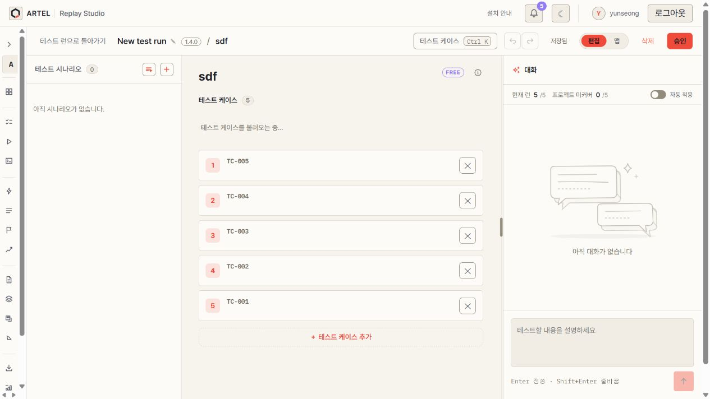

# TC 시연 제거 화면 확인

2026-10-28 로컬 frontend build와 기존 orchestration으로 시나리오 편집 상단에서 시연 버튼이 제거된 것을 확인했다. QA 녹화·판정 검토 기능의 코드는 유지했다. 화면에 함께 보이는 TC 번호 변경은 별도 세션 작업이다.

이 캡처에서는 케이스 상세 데이터가 로딩 상태여서 게임 QA 전체 동작 검증으로 사용하지 않는다. 이후 QA history 추가 확인은 브라우저의 페이지 이동 응답 지연으로 완료하지 못했다.

시연 제거분만 적용한 격리 snapshot에서 test 1,547개와 build가 통과했다. 변경 파일 lint도 통과했다. 전체 lint는 기존 useCaseListNav.ts·useStepEditor.ts의 React hooks 오류 4개와 warning 4개로 실패했다.
