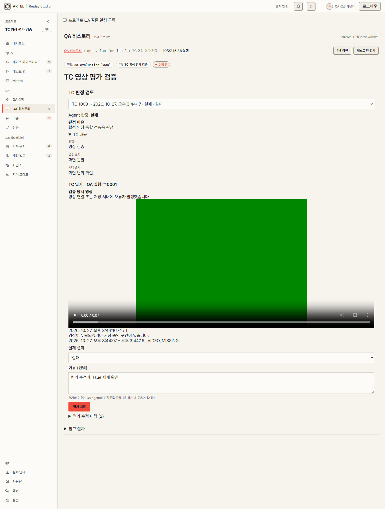
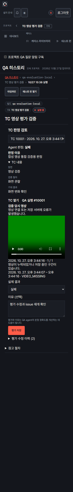
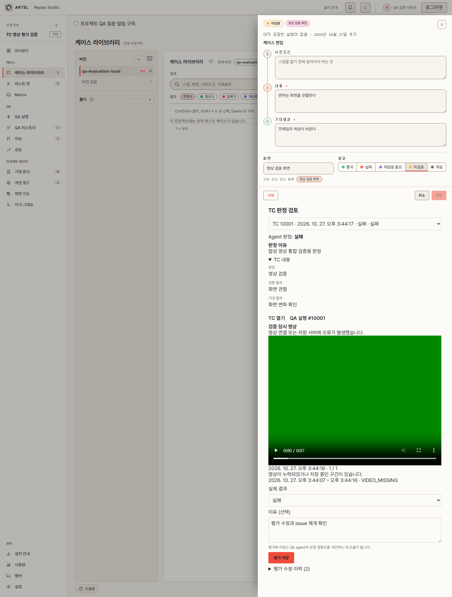
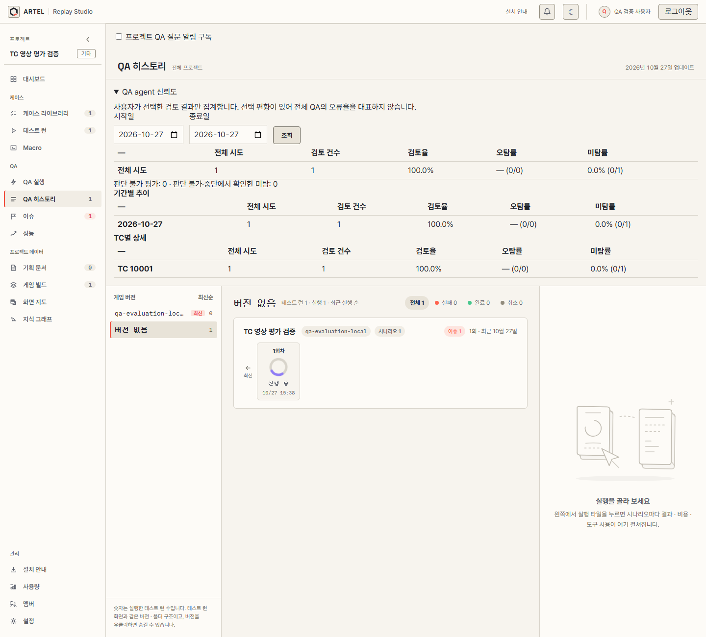
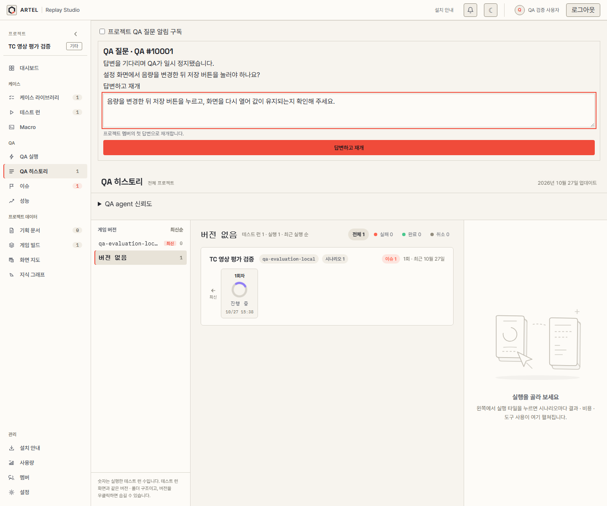
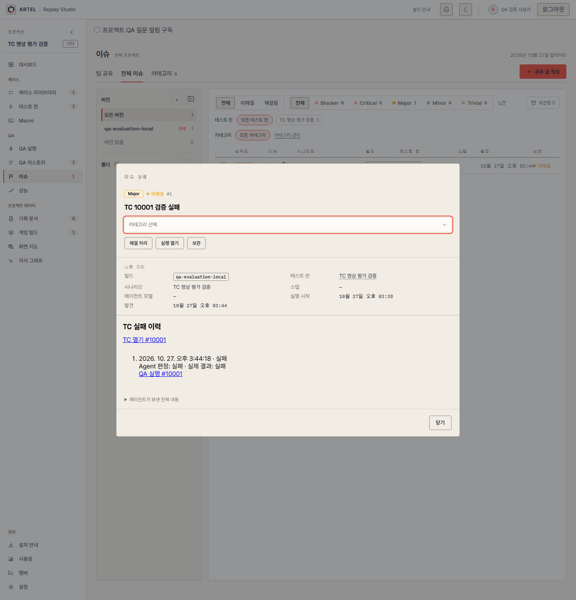

# TC 평가 화면과 영상 재생 검증

2026-10-27에 자동 테스트와 초기 통합 검증을 진행했고, 2026-10-28에 최종 CSS를 적용한 화면을 로컬 orchestration 서버·S3와 연결해 다시 촬영했다. 실제 Unity 게임의 QA 결과나 Agent 정확도 벤치마크는 아니다. 화면에 보이는 사용자·프로젝트·TC는 검증용 데이터다.

## 실행 환경과 명령

- Vite: `http://localhost:5176`
- orchestration: 공개 API `http://localhost:8090`, 내부 API `http://localhost:8091`
- DB: 별도 검증 DB `artel_qa_evaluation_20261027`
- 브라우저: Playwright와 설치된 Chromium headless
- 인증: `artel-jwt` 스크립트로 검증용 사용자 세션을 발급하고 브라우저 cookie에 설정했다. JWT와 signing secret은 문서·스크린샷에 포함하지 않았다.

`artel-home` worktree에서 화면을 실행했다.

```powershell
$env:VITE_ORCHESTRATION_URL='http://localhost:8090'
npm run dev -- --host 127.0.0.1 --port 5176 --strictPort
```

상위 workspace의 임시 Playwright 스크립트로 실제 화면을 열고 영상 재생·키보드 이동·스크린샷을 확인했다. API 응답을 mock하거나 프록시로 대체하지 않은 최종 실행이다.

```powershell
node ../qa-evaluation-ui-check.cjs
node ../qa-evaluation-final-screenshots.cjs
npm run typecheck
npx eslint src/qa/evaluation src/projects/workspace/ProjectWorkspace.tsx src/testCases/TestCaseSheet.tsx
npm test
```

## 확인 결과

| 항목 | 확인한 결과 |
| --- | --- |
| 로그인 | 실제 `/api/auth/me` 응답 200 후 프로젝트 화면 표시 |
| QA history·TC 평가 | 원래 판정, 판정 이유, TC 내용·기대 결과, 평가 입력란, 수정 이력 2건 표시 |
| 영상 | 두 화면에서 실제 S3 URL로 재생. `readyState=4`, 재생 위치 증가, `videoWidth=640`, `video.error=null` 확인 |
| 신뢰도 | 프로젝트 전체·기간별·TC별 집계와 검토 건수·선택 편향 표시. 합성 시도 1건, 검토 1건, 검토율 100% 확인 |
| 한국 날짜 조회 | 10월 27일 선택 시 `2026-10-26T15:00:00Z`부터 `2026-10-27T15:00:00Z` 미만으로 요청 |
| 누락 구간 | TC 검증 시작 10초 전부터 결과 보고 5초 후 사이로 표시 범위 제한 |
| viewport | 1440px, 1024px, 360px에서 확인. 1024px·360px의 문서 가로 폭이 viewport와 일치 |
| theme | 라이트 화면과 QA 평가 화면의 다크 theme 전환·영상 표시 확인 |
| keyboard | 실제 결과 선택란에서 Tab으로 이유 textarea, 다음 Tab으로 평가 저장 버튼에 이동 |
| 질문 | 내부 API로 질문을 만들고 대기 화면을 표시했다. 브라우저 답변 저장 후 질문이 해제됐다. 실제 게임 agent 재개는 이 검증에 포함하지 않았다. |
| TC issue | 실패 이력, 원본·실제 판정, TC와 QA 실행 링크를 실제 API로 조회했다. |
| 오류 | 최종 브라우저 실행에서 HTTP 400 이상 응답, `pageerror`, console error 없음 |

프런트엔드 전체 테스트 1,498개가 통과했다. 신규 평가 모듈 테스트 12개에는 API 주소 중복 방지, snapshot 필드 해석, 영상·누락 구간 범위, 만료, 한국 날짜 경계가 포함된다.

breadcrumb·제목 아래로 평가 패널을 옮긴 마지막 수정 후 `npm run typecheck`, 변경한 TS/TSX 파일의 ESLint, 신규 평가 모듈 12개 테스트를 다시 실행해 모두 통과했다.

초기 스크린샷에서 360px 화면의 긴 TC 선택 항목이 영상과 입력란을 오른쪽으로 밀어내는 문제를 발견했다. 평가 패널과 입력 폼의 열을 `minmax(0, 1fr)`로 지정하고 입력 요소에 `min-width: 0`을 적용했다. 10월 28일 실제 API와 연결한 최종 화면에서 QA history 영상의 좌우 경계는 40~320px, TC 상세 영상은 약 64~326px였다. 선택란·영상·textarea가 패널 경계를 넘지 않는 것도 검사했다. 신뢰도 표는 좁은 화면에서 표 내부를 가로 스크롤한다.

## 화면

영상의 초록 화면은 합성 영상이다. fixture에 실제 SDK가 계속 연결되어 있지 않아 연결 오류와 누락 구간 안내가 함께 표시된다. 이미 저장된 영상은 이 상태에서도 재생된다.

### 데스크톱 평가 화면



### 모바일 다크 평가 화면



### TC 상세 평가 화면



[360px TC 상세 화면](images/qa-evaluation-tc-mobile.png)

### 프로젝트 신뢰도 화면



[360px 신뢰도 화면](images/qa-evaluation-reliability-mobile.png)

### 질문 대기와 답변 입력 화면



[360px 질문 화면](images/qa-evaluation-question-mobile.png)

### TC 실패 issue 이력 화면



[360px issue 화면](images/qa-evaluation-issue-mobile.png)

실제 Unity 연결, 운영 브라우저의 알림 권한 승인·알림 전달, 장시간 실행은 이 브라우저 검증 범위에 포함하지 않았다.
