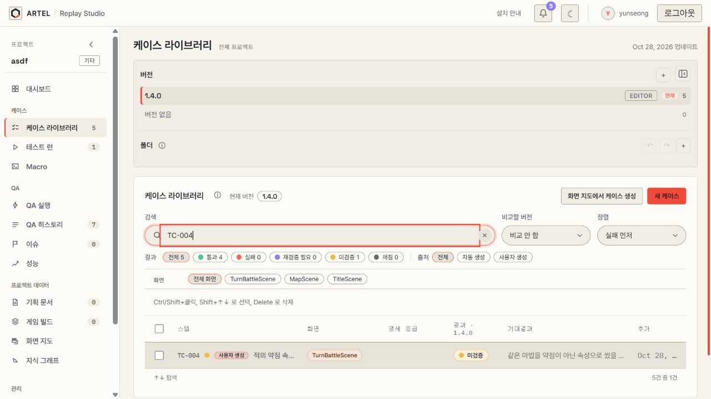
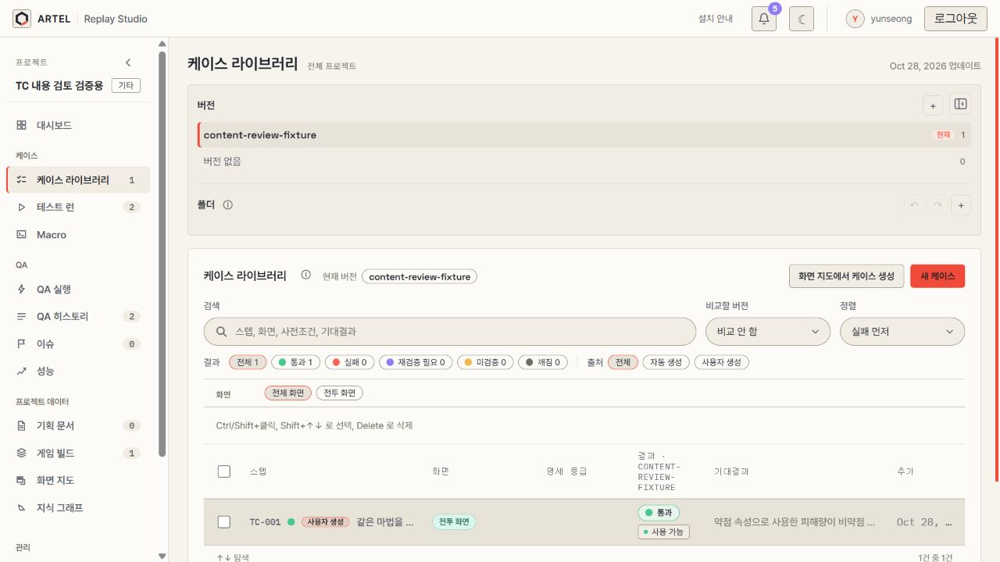
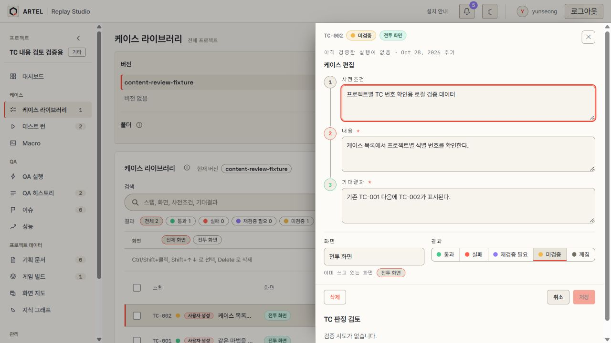
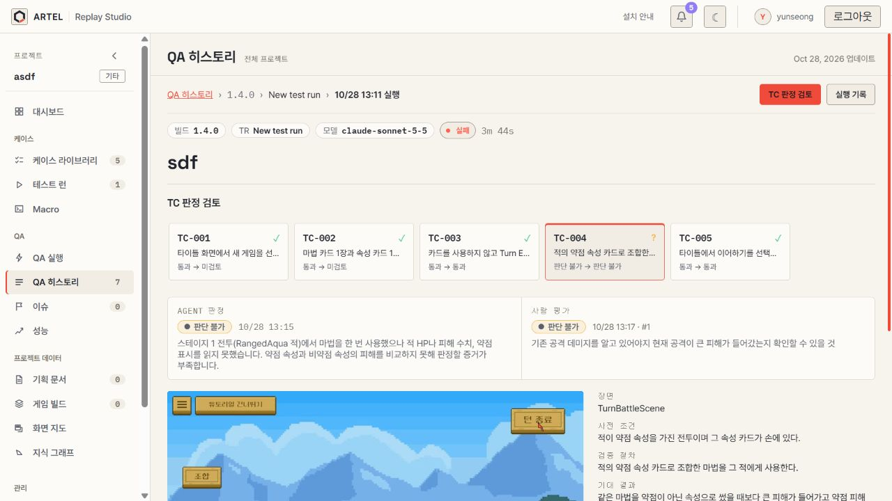
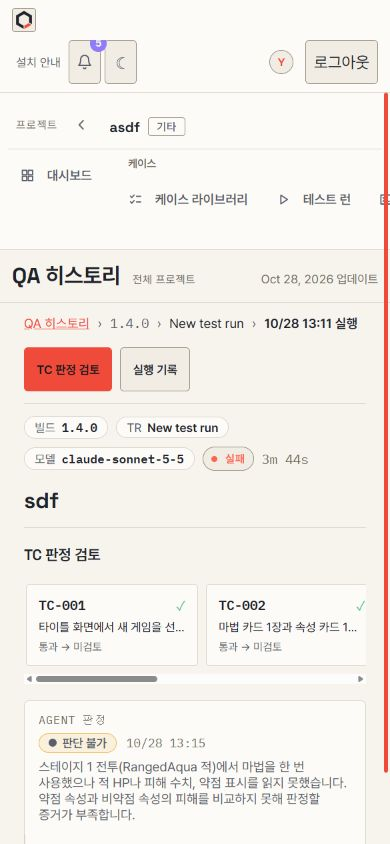

# 프로젝트별 TC 식별 번호 표시 추가

TC 번호는 프로젝트 안에서만 유일하다. 프로젝트별 서버 mapping을 공통 provider에서 읽고 목록·상세·호버·QA 검토 바·실행 기록·시나리오·신뢰도·이슈의 TC 링크에 같은 번호를 표시한다. 내부 ID와 URL은 그대로 사용한다.

검색은 `TC-004` 같은 표시 번호와 기존 내부 ID를 지원한다. 정렬·필터·빌드 전환으로 번호를 바꾸지 않는다. 반복 등장하는 같은 TC에도 같은 번호를 표시한다.

프로젝트를 바꾸면 이전 프로젝트의 mapping을 표시하지 않는다. 번호 조회 실패는 재시도할 수 있으며, 알 수 없는 번호는 `TC-…`로 표시한다. mapping이 준비되기 전에는 재검증 실행을 만들지 않아 임시 번호가 실행 이름에 저장되지 않게 한다.

## 화면 검증 기록

로컬 서버와 실제 UI로 프로젝트 1·검증용 프로젝트 110147의 독립 `TC-001`, 새 TC의 `TC-002` 발급, `TC-004` 검색·상세·QA 검토 바 연결을 확인했다. 검증용 프로젝트에만 새 TC를 추가했으며 실제 프로젝트의 TC와 평가 값은 수정하지 않았다. 새 게임 QA를 실행한 검증은 아니다.

최신 PR 변경을 포함한 화면 테스트 1,554개, TypeScript build, 변경 파일 ESLint가 통과했다. 서버의 번호 조회 API를 먼저 적용해야 한다.
